> [!IMPORTANT]
> ### Want to stay up to date? Download the launcher.
> **The launcher always gets you the newest FPV DVR Cleaner.** Pick your system, and it downloads the latest release into its own folder (or a folder you choose), checks it, deletes the old version and starts the app.
>
> **[⬇ Launcher for Windows](https://github.com/Bratwurstexe/FPV_DVR_CLEANER/releases/latest/download/FPV-DVR-Cleaner-Launcher-windows-x64.exe)**&ensp;·&ensp;**[macOS Apple Silicon](https://github.com/Bratwurstexe/FPV_DVR_CLEANER/releases/latest/download/FPV-DVR-Cleaner-Launcher-macos-apple-silicon.zip)**&ensp;·&ensp;**[macOS Intel](https://github.com/Bratwurstexe/FPV_DVR_CLEANER/releases/latest/download/FPV-DVR-Cleaner-Launcher-macos-intel.zip)**&ensp;·&ensp;**[Linux](https://github.com/Bratwurstexe/FPV_DVR_CLEANER/releases/latest/download/FPV-DVR-Cleaner-Launcher-linux-x64.tar.gz)**
>
> <p align="center">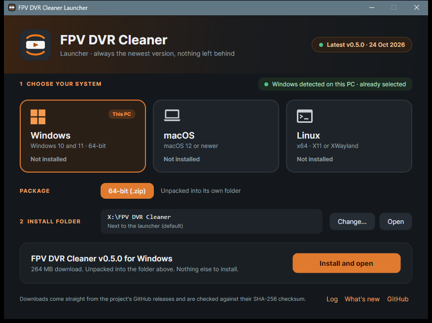</p>


<div align="center">


# FPV DVR Cleaner

[](LICENSE)
[](https://github.com/Bratwurstexe/FPV_DVR_CLEANER)
[](#getting-started)
[](https://dotnet.microsoft.com)
[](https://www.python.org)
[](https://github.com/Bratwurstexe/FPV_DVR_CLEANER/stargazers)
[](https://github.com/Bratwurstexe/FPV_DVR_CLEANER/releases)

**Open-source restoration for analog and HDZero DVR recordings.**
Removes rainbow stripes and black-and-white dropouts, rebuilds HDZero breakups, paints out the OSD and upscales the result, all on your own computer.
**Uses your processor and graphics card together, automatically:** the heavy pixel work runs on the GPU (NVIDIA, AMD, Intel or Apple), everything else on all CPU cores, for full speed at the same quality.

<h2><a href="https://github.com/Bratwurstexe/FPV_DVR_CLEANER/releases/latest">⬇ Download for Windows, macOS and Linux</a><br><sub>Ready to run, no Python or FFmpeg setup.</sub></h2>

<hr>

<p align="center"><a href="#features"><b>Features</b></a>&ensp;·&ensp;<a href="#before-and-after"><b>Before / after</b></a>&ensp;·&ensp;<a href="#speed"><b>Speed</b></a>&ensp;·&ensp;<a href="#how-it-works"><b>How it works</b></a>&ensp;·&ensp;<a href="#the-workflow"><b>Workflow</b></a>&ensp;·&ensp;<a href="#getting-started"><b>Getting started</b></a>&ensp;·&ensp;<a href="#coming-soon"><b>Coming soon</b></a>&ensp;·&ensp;<a href="#licence"><b>Licence</b></a></p>

<hr>

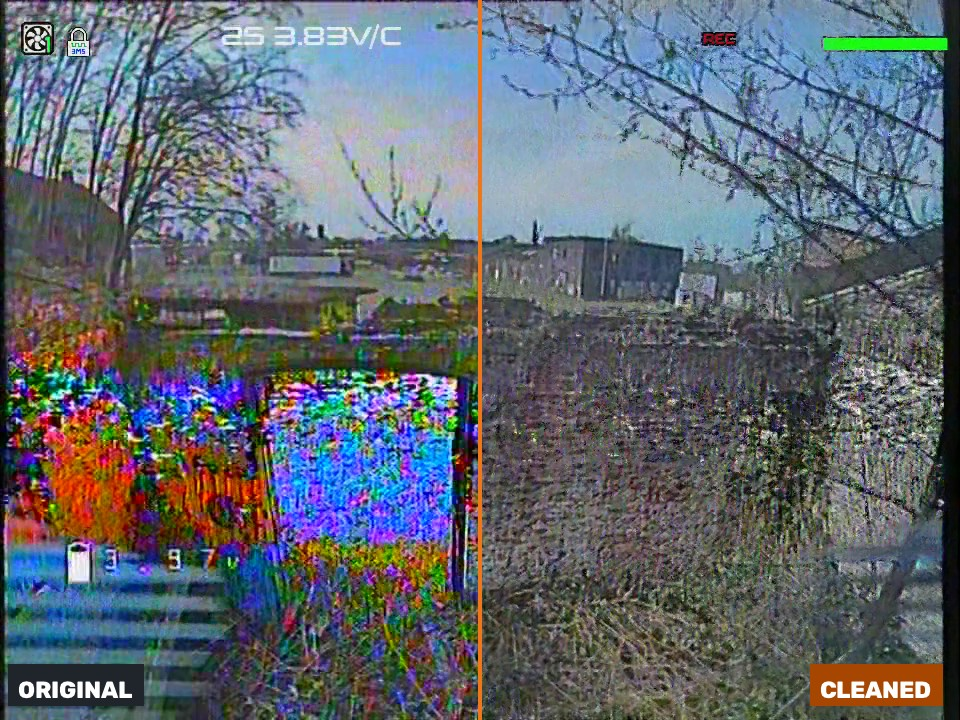

</div>

---

## Features

- **Rainbow stripes removed.** Hue tears from a disturbed colour carrier are detected in each frame and replaced with colour from neighbouring frames.
- **Black-and-white dropouts filled.** Frames or row bands where the receiver lost colour get their colour back; the brightness is never touched.
- **HDZero breakups rebuilt.** Frames or parts of frames that turn into coloured confetti when the digital link drops packets are rebuilt from the clean frames around them, even when the whole frame is lost.
- **Noise reduction and streak repair.** Five motion-aligned frames are fused around a robust median. Grain calms down, bright or dark streaks disappear, and moving edges stay sharp.
- **OSD removal.** Text, icons and bars that stay in place while the picture moves are found, including warnings that appear only briefly. They are refilled from frames where the scene behind them is visible. Screens that are shown only part of the time, such as the stats after landing, are removed only while they are on screen. If the search misses something, such as a small icon or *REC*, **Fix by hand** opens a mask editor: paint it in (or keep what was taken by mistake), and the correction is used in every frame of that recording.
- **Multi-frame upscaling.** 1.5× (720p to 1080p) or 2×. Neighbouring frames add detail instead of just enlarging a single frame.
- **A finished look, if you want one.** Switch on a look to give the cleaned footage a final touch: colour grade, glow, vignette, film grain and lens fringe, each with its own slider, or one of the presets *Clean*, *Cinematic*, *Punchy* and *Retro FPV*. It is off by default and then changes nothing. The frame preview shows it, and a second split compares the frame with and without it.
- **Timeline trim editor.** Cut a recording into parts and remove the ones you don't want, like in a video editor: split at the playhead, click a part, press Delete, and the rest closes up with a visible cut edge. Drag the edges to trim, snap to cuts and bookmarks, hover to scrub, Ctrl+wheel to zoom, undo and redo. The audio track is shown as a waveform, and playback decodes the real video, so it runs smoothly.
- **Two simple questions.** Pick the signal (Analog or HDZero) and answer *How bad is it?* with Light, Normal or Strong; *Best quality* adds 1080p in one switch. Every slider is still there under *Advanced*, each with a *Show* button that renders the frame without and with only that repair.
- **Check before you export.** The frame at the playhead runs through the whole chain and updates on its own after a change; drag the split line across the picture to compare original and result.
- **Watch the result live.** After the export, original and cleaned clip play side by side (or under a wipe you drag in the picture), frame-accurate to each other, with removed parts skipped. A measurement tells you how much was gained, how much is still possible without any loss, and what a second pass would cost. *Auto refine* picks the settings from that measurement and exports again with one click.
- **Share-ready before/after videos.** One click after the export makes a video to post: original and cleaned side by side, under a sweeping orange wipe, or in alternating cuts, as 16:9 for YouTube or 9:16 for Shorts, Reels and TikTok (stacked, or one full-screen picture that follows the action). The frames the repair changed most, such as a breakup or a rainbow tear, can play in slow motion and freeze for a moment. Take the whole clip or the best 15, 30 or 60 seconds, chosen around the strongest repairs, with or without the original sound. A small *Cleaned with FPV DVR Cleaner* sits in the corner unless you switch it off.
- **Export by purpose.** Say what the video is for: *Share & play anywhere* (MP4 with H.264), *Smallest file* (MP4 with H.265), *For video editing* (MOV with ProRes 422) or *For the web* (WebM with VP9 and Opus). MKV, quality and size limit are under *More options*. The choice is remembered.
- **Batch export.** Every clip keeps its own cut. The remaining time is shown live, you can cancel at any moment, and the original audio is kept. Clips can be joined into one video, the file name suffix is yours to choose, and the folder opens when it's done.
- **Presets and memory.** Save your settings as presets of your own, then rename, update or delete them. The last settings, the export folder, the cut of every recording and its OSD corrections come back the next time you start the app.
- **CPU and GPU together.** Frames are repaired in parallel on every core, the full-resolution work of noise reduction and upscaling runs on the graphics card, black side bars are skipped, and a *Fast / Balanced / Best* setting trades time for quality. Without a usable GPU everything runs on the CPU with the same result. See [Speed](#speed).
- **Optional local training.** A small self-supervised model can learn your receiver's pixel statistics from your own footage.
- **One screen, one focus.** Every page fits the window without scrolling, the trim editor is a dark workspace with the preview as large as the window allows, and while the engine works on a frame the page blurs behind a single progress card; an export shows its progress right under the Export button.
- **Private.** No account, no upload, no telemetry. Everything runs locally.

Restoring VHS tapes or old 8 mm / 16 mm film? That lives in the sister project [Analog Repair](https://github.com/Bratwurstexe/ANALOG_REPAIR).

## Before and after

All examples are real DVR recordings. Each analog image shows the full 4:3 picture and, below it, the marked area enlarged 2x.

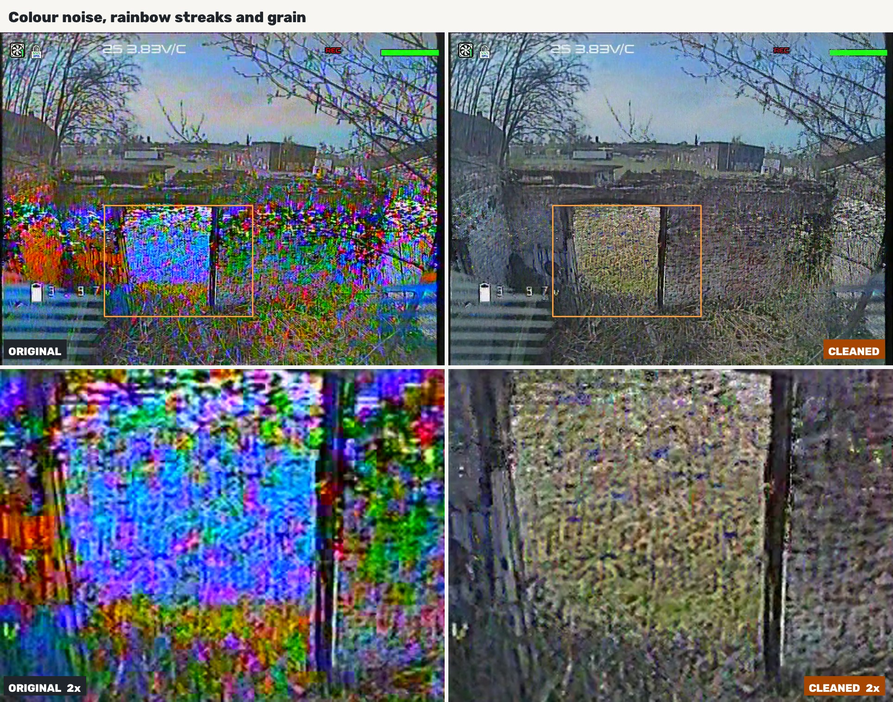

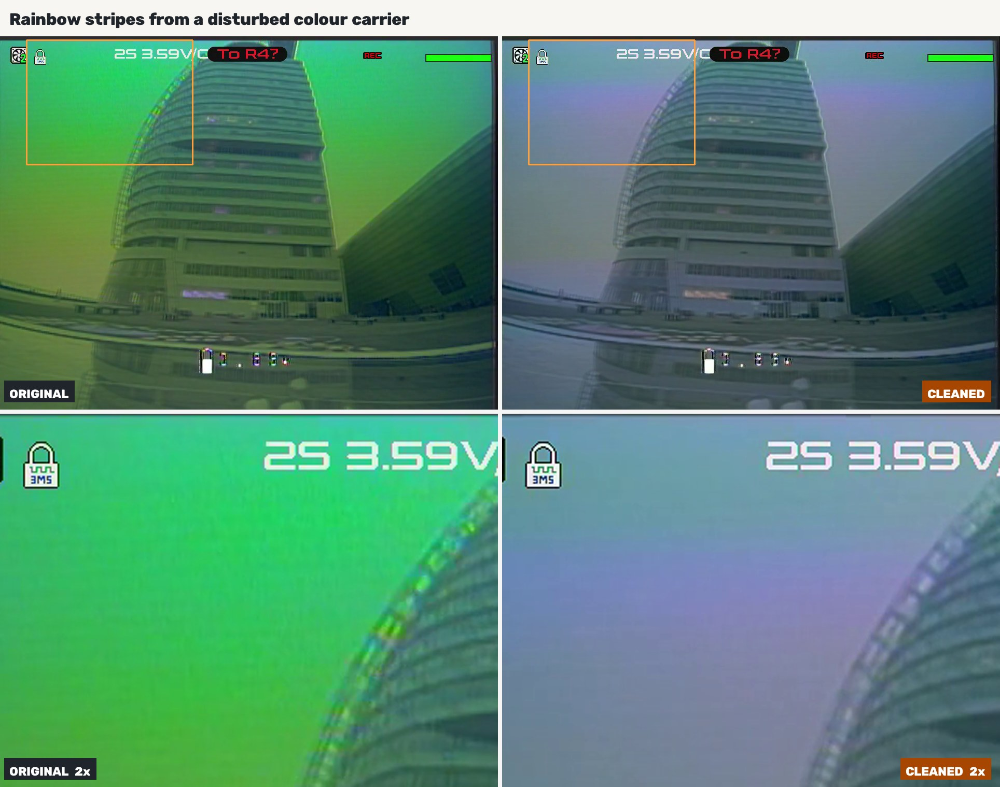

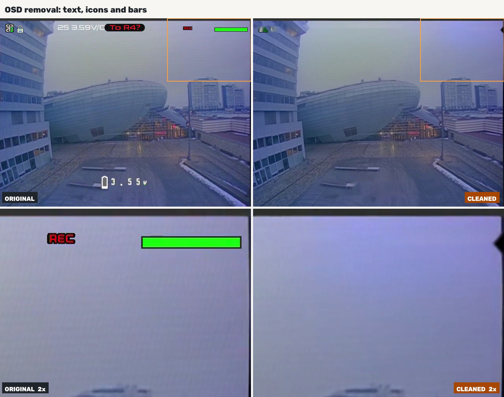

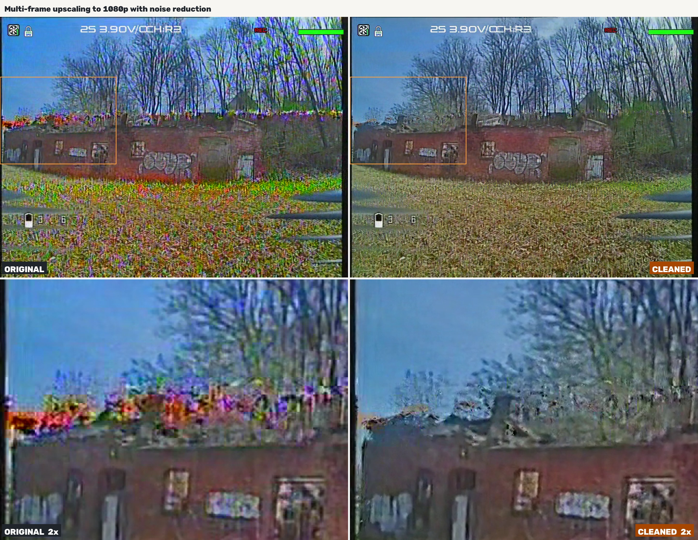

### HDZero breakups

Two frames from an HDZero recording in which the link dropped out: half the frame, then the whole frame lost to confetti, and the rebuilt result. Below, scattered confetti over the post-flight stats; the OSD stays intact.

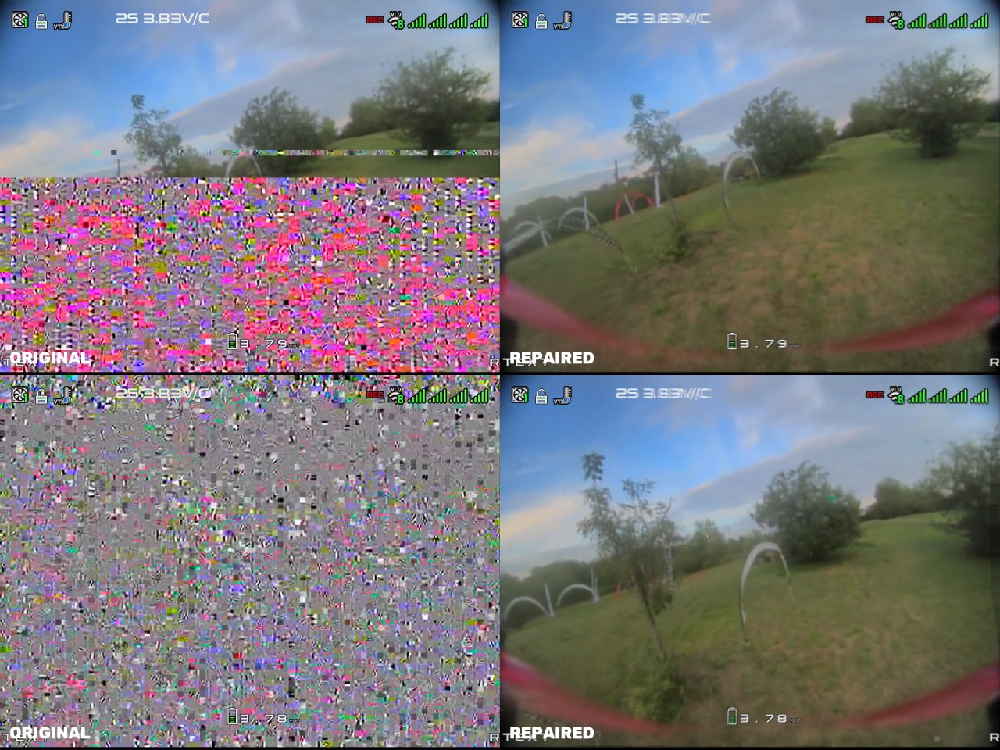

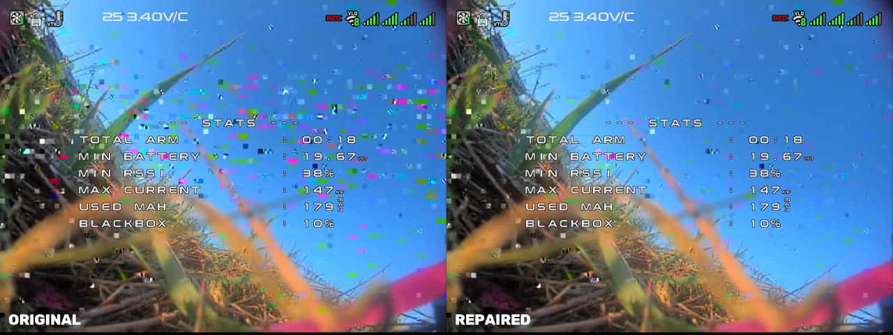

### In motion

| Colour noise and streaks | Rainbow stripes |
|---|---|
| 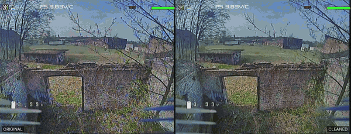 | 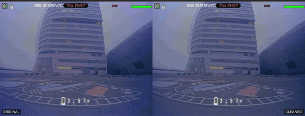 |
| **OSD removal** | **1.5x upscaling (detail)** |
| 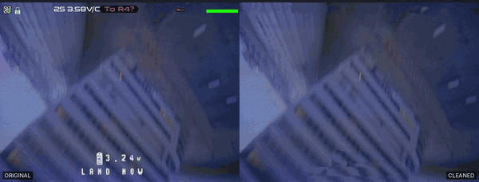 | 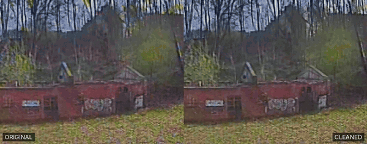 |

## Speed

How long an export takes, in minutes of processing for one minute of footage. Pick the speed on the *Repair* page: **Fast** for a quick look at a flight, **Balanced** (default) for most exports, **Best** for the final cut.

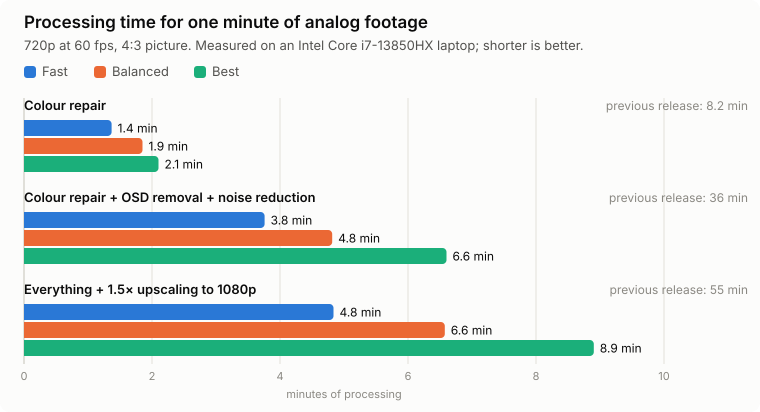

| Repair steps | Fast | Balanced | Best | Balanced, CPU only |
|---|---:|---:|---:|---:|
| Colour repair | 1.7 min | 2.1 min | 2.1 min | 2.1 min |
| Colour repair + OSD removal + noise reduction | 3.5 min | 3.9 min | 4.6 min | 6.4 min |
| Everything + 1.5× upscaling to 1080p | 4.1 min | 4.8 min | 5.8 min | 10 min |

Measured with 0.5.0 on 20 seconds of a real 720p60 analog recording (4:3 picture in a 16:9 file) on a desktop PC with an AMD Ryzen 5 5600 (6 cores, 12 threads), an NVIDIA GeForce RTX 3070 and 32 GB of memory. The last column is the same export with the graphics card switched off (`FLUGBILD_GPU=0`). The GPU makes noise reduction and upscaling about 40 to 50 % faster here; colour repair runs on the CPU and does not change. The raw numbers are in [docs/benchmarks](docs/benchmarks/ryzen5-5600-rtx3070.json).

**Your speed will differ.** It depends on your processor and graphics card: processors with more cores finish sooner, laptops are held back by their power limit, and without a usable GPU everything runs on the CPU as in the last column. Recordings at 90 or 180 fps take proportionally longer, because every frame is repaired. To measure your own machine, run [tools/benchmark.py](tools/benchmark.py) on one of your recordings and draw the chart with [tools/make_speed_chart.py](tools/make_speed_chart.py).

## How it works

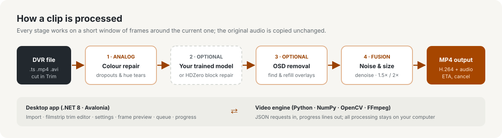

The desktop app (.NET 8, Avalonia) is the front end: import, trimming, settings, preview and the export queue. All video work happens in a Python engine built on NumPy, OpenCV and FFmpeg. The two talk through small JSON requests and progress lines, so the engine can also be used and debugged on its own.

Each stage streams frames and looks at a short window of neighbours around the current frame:

### 1 · Analog colour repair

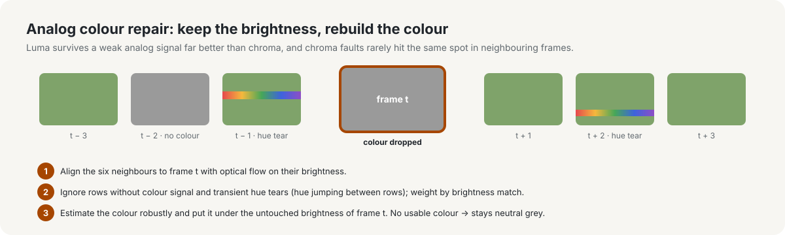

A weak analog signal damages colour far more than brightness, and the damage changes from frame to frame. The repair keeps the brightness of every frame and re-estimates only its colour:

- **Colour dropout:** a row with practically no colour signal is recognised by an absolute chroma level. A truly grey scene simply stays grey.
- **Hue tears (rainbow stripes):** saturated colour whose hue jumps from one row to the next. Only *transient* jumps count. An edge that shows the same jump in the neighbouring frames, such as a red roof against the sky or a coloured OSD bar, is part of the picture.
- **Estimate:** three earlier and three later frames are aligned with optical flow and weighted by how well their brightness matches. The colour is then estimated with a robust (Cauchy) average. If no neighbour has usable colour, the result fades to neutral grey instead of copying a stripe.
- **Lasting bands:** a stripe that returns at the same place in several frames is caught by its edges: a colour edge without a matching brightness edge. There the colour is refilled from a local brightness-to-colour model.
- **Settle:** finally the colour is smoothed with a filter guided by the brightness, so it follows the contours that survived the transmission instead of speckling.

### 2 · HDZero breakup repair and optional model

You can add a small network trained on your own recordings (*Model training*).

When the HDZero link drops packets, the decoder paints parts of a frame, or all of it, with blocks of random colour. The frames around it are usually intact, so they are used to rebuild it:

- **Finding:** for every 16 px block, the energy of fine colour detail is measured. Real pictures have little of it and motion blur even less, while confetti consists of it. A block counts as broken when it is high there and clearly lower in *both* neighbouring frames, so colourful things that are always there, such as the OSD or text that just appeared, are left alone. Single specks are counted by their share of the block. When most of the frame is broken, the whole frame is rebuilt.
- **Rebuilding:** the nearest frames before and after that are clean at those blocks are aligned with optical flow measured *between the two of them*, never in the broken frame. The in-between picture is blended into the broken blocks with a soft edge.

What the detector sees: outlined blocks are rebuilt, a yellow frame means the whole frame is rebuilt.

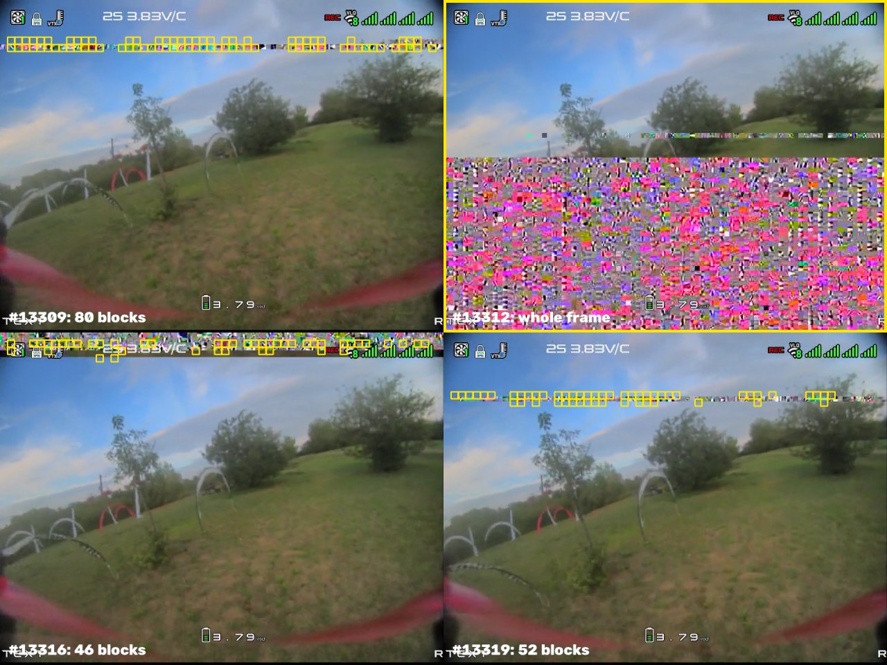

Slowed down, frame by frame: original, detected blocks, result.

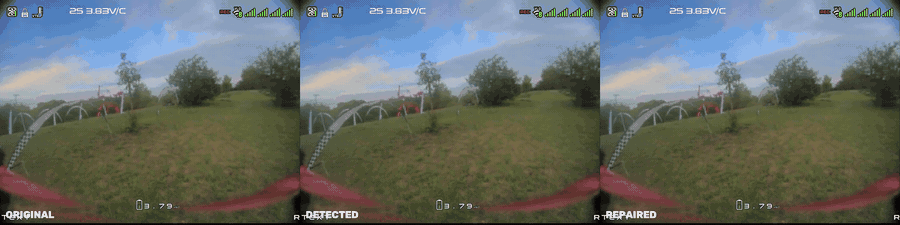

### 3 · OSD removal

- **Finding overlays:** at the edge of a drawn overlay, the brightness gradient points the same way in every frame. At scene edges it points in all directions as the drone moves. Comparing summed gradient *vectors* with summed gradient *lengths* per colour channel marks edges that hold still. These edges are grouped into text lines and shapes, and closed outlines such as bars are filled.
- **Brief overlays:** a sliding window applies the same test to warnings that appear only for a moment, but only while the scene is moving. A straight scene edge that slides along itself also keeps its direction, so only flat, level rows full of upright strokes count: lines of text such as *LOW BATTERY*.
- **Only while shown:** the clip-wide search also finds screens that are visible only part of the time, such as the stats after landing. For each element the edges that held still are remembered with their direction; a frame shows the element when enough of them are found there again. Changing digits have no steady edges, so the icon, point and unit decide. An element stays removed a moment longer after it was last seen, so blinking warnings do not flicker.
- **Removal:** each region is filled from the neighbouring frame whose aligned content fits the region's rim best, with its brightness offset corrected. Motion is chained frame by frame, so even frames far apart line up. Where no frame shows the background, the region is inpainted.

### 4 · Multi-frame fusion: noise reduction and upscaling

The current frame and two frames on each side are aligned onto the same grid. If upscaling is on, they are enlarged with Lanczos first.

- The per-pixel **median** of the five values is the reference. A bright or dark streak in one frame is an outlier against it and gets replaced, and random grain averages out.
- Every value is weighted by its distance to that reference. Where the aligned frames disagree among themselves, for example because of occlusion or a wrong motion estimate, the original pixel is kept, so nothing ghosts.
- A mild, clipped detail lift follows, which avoids halos.

**Look (optional).** When a look is switched on, it is the last step before the encoder, after every repair: a gentle grade (contrast, saturation, cool shadows and warm highlights), a glow from the brightest parts blurred at quarter size, red and blue scaled slightly apart towards the edges like a cheap lens, a vignette and film grain at half resolution. The grain is seeded with the frame number, so exporting the same cut twice gives the same file. When the look is off, this step does not run at all.

The output is H.264 MP4 with the original audio unless you pick another format on the Export page: H.265 MP4, ProRes 422 MOV (with uncompressed sound), H.264 MKV or VP9 WebM (with Opus sound). Results are written to a temporary file and only renamed when the export succeeds.

### 5 · How it stays fast

- **Every core works.** Each stage builds a frame only from its input neighbours, never from its own earlier output, so frames are processed side by side on a shared thread pool while the order is kept.
- **The graphics card takes the heavy part.** In noise reduction and upscaling, optical flow is measured on small frames on the CPU threads; warping the neighbours, the median and the weighting at full resolution run on the GPU through OpenCL, which NVIDIA, AMD, Intel and Apple drivers provide. Only two frames at a time go to the GPU, more would only queue up there, while the other threads keep the processor busy with flow, colour repair and OSD removal. At start a short self-test compares the GPU with the CPU; if it fails, or no GPU is found, the CPU does everything. The result is the same either way, to within one grey level. `FLUGBILD_GPU=0` turns the GPU off.
- **Only the picture.** Goggles record the 4:3 picture inside a 16:9 file. The black side bars are found once per cut, skipped by every stage and added back as clean black: about a quarter less work.
- **Fast / Balanced / Best** sets how many neighbouring frames are used, how finely motion is followed and how fast the encoder runs. *Best* is the full-quality setting; *Balanced* is close to it in clearly less time.

## The workflow

| 1 · Import | 2 · Trim |
|---|---|
| 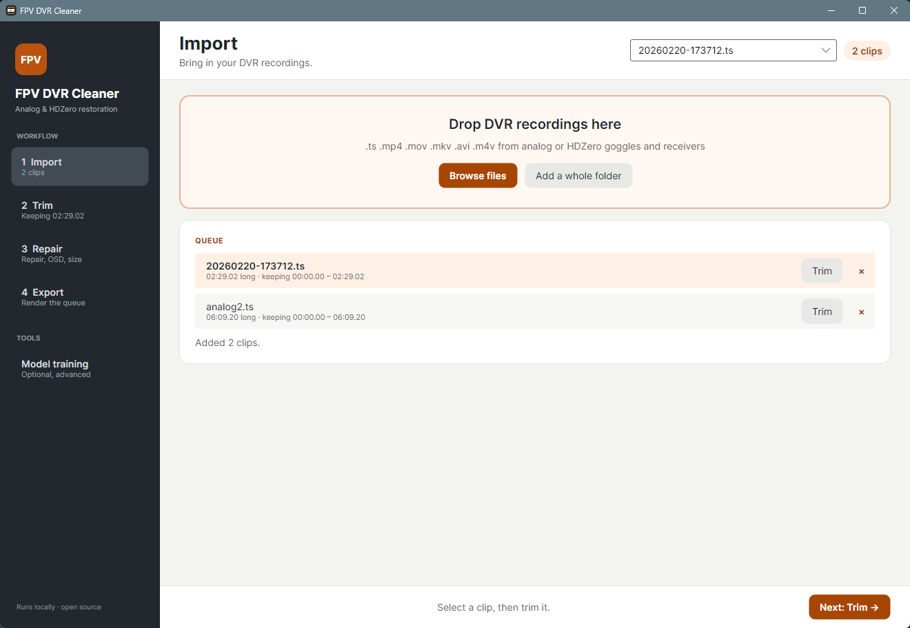 | 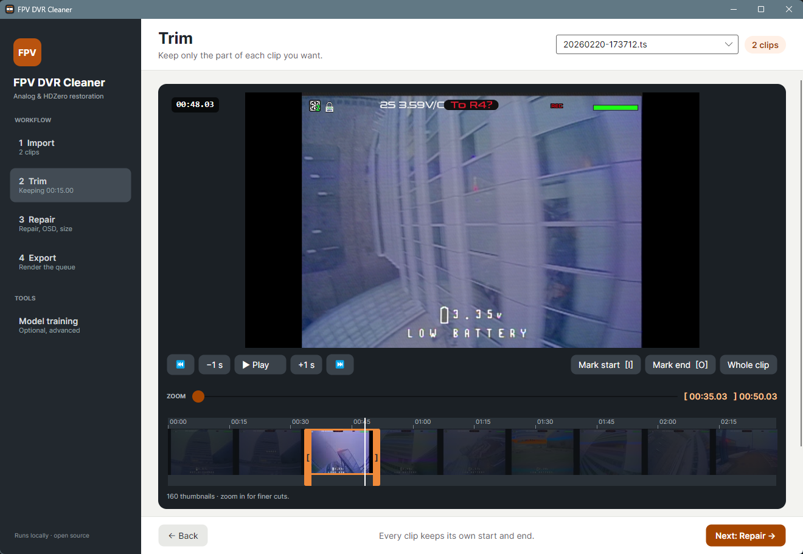 |
| **3 · Repair** | **4 · Export** |
| 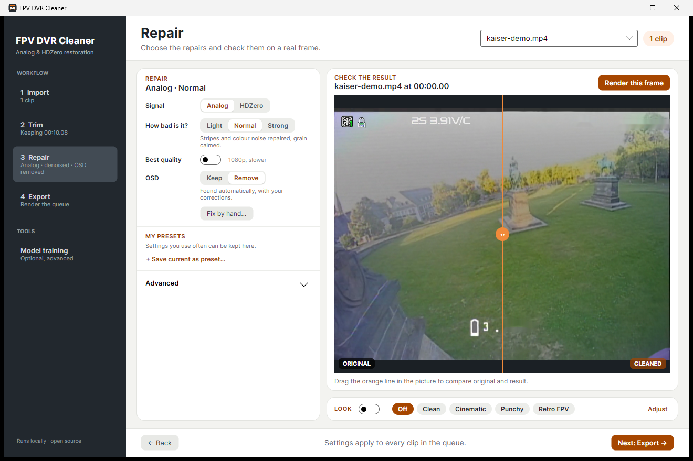 | 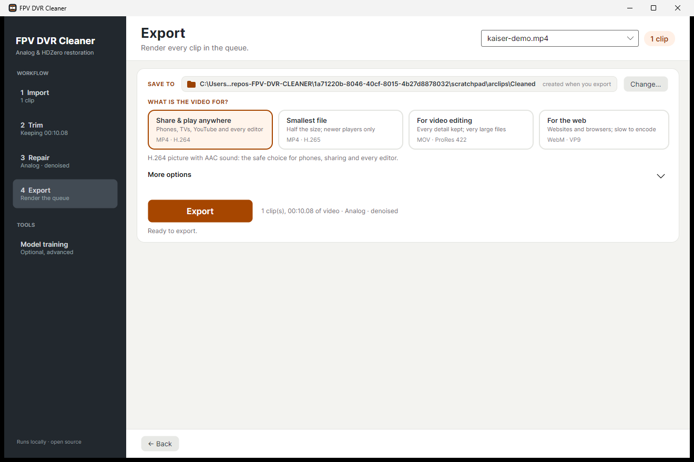 |

1. **Import:** drop recordings onto the window or add a folder.
2. **Trim:** split the recording at the playhead (`S`), click the parts you don't want and press `Delete`; the kept parts close up. Drag the `[` `]` edges to fine-tune, set bookmarks with `B`, play through the kept parts with `Space`.
3. **Repair:** choose Analog or HDZero and how bad the recording is, switch on *Best quality* for 1080p, keep or remove the OSD (and fix its mask by hand if needed) and, if you like, add a look. The frame on the right shows the result; *Advanced* holds every slider, output size and speed. Save settings you like under *My presets*.
4. **Export:** check the folder (a *Cleaned* folder next to your clips unless you choose another), pick what the video is for and press *Export*. The remaining time is shown live, and you can cancel at any moment. Afterwards, play original and result side by side, read the gain and headroom estimate, and press *Auto refine* to export again with settings chosen from it, or refine the cleaned file in a second pass.
5. **Share:** press *Share* in the result view, pick 16:9 or 9:16 and a layout, and press *Make video*. Length, slow motion, sound and the watermark are under *More options*. The video is saved next to the cleaned file as `…-share.mp4` or `…-short.mp4`.

## Getting started

### Download

**Easiest: the launcher.** Download the launcher for your system (links at the [top of this page](#fpv-dvr-cleaner)), put it in a folder of your choice and start it. Your system is detected and preselected, but you can pick another one. It downloads the newest release, verifies its SHA-256 checksum, unpacks it next to itself, removes the old version and starts the app. Start it again whenever you like: it updates only when there is something new. You can choose another install folder at any time; the choice is remembered.

Or get the package for your system from the **[latest release](https://github.com/Bratwurstexe/FPV_DVR_CLEANER/releases/latest)** yourself. It contains the app, the video engine and FFmpeg. Unpack it and start it; nothing else has to be installed.

| System | File | Start |
|---|---|---|
| Windows 10/11 (64-bit) | `FPV-DVR-Cleaner-…-windows-x64.zip` | `FpvDvrCleaner.Desktop.exe` |
| macOS, Apple Silicon | `FPV-DVR-Cleaner-…-macos-apple-silicon.zip` | `FPV DVR Cleaner.app` |
| macOS, Intel | `FPV-DVR-Cleaner-…-macos-intel.zip` | `FPV DVR Cleaner.app` |
| Linux (x64) | `FPV-DVR-Cleaner-…-linux-x64.AppImage` | `chmod +x` the file, then start it |
| Linux (x64), plain folder | `FPV-DVR-Cleaner-…-linux-x64.tar.gz` | `./FpvDvrCleaner.Desktop` |

On Windows, SmartScreen may warn about an unknown publisher: choose *More info → Run anyway*. On macOS the app is not notarised: right-click it and choose *Open* the first time. The launcher gets the same one-time questions (on macOS: right-click *FPV DVR Cleaner Launcher.app* → *Open*; on Linux: unpack it and start `FPV-DVR-Cleaner-Launcher`); the app it installs then starts without them. On Linux the app needs an X11 or XWayland session (Wayland compositors such as Hyprland or Sway run it through XWayland).

The export folder you choose is remembered between runs. Settings and trained models are kept in `FPV DVR Cleaner` under your user's local application data folder (`%LOCALAPPDATA%` on Windows, `~/.local/share` on Linux, `~/.local/share` or `~/Library/Application Support` on macOS).

### Requirements (run from source)

- Windows 10/11, Linux or macOS
- [.NET 8 SDK](https://dotnet.microsoft.com/download/dotnet/8.0) (to build the app)
- Python 3.10 or newer with `pip install numpy opencv-python-headless`
- [FFmpeg](https://ffmpeg.org/download.html) and `ffprobe` on your `PATH`

### Run from source

```powershell
git clone https://github.com/Bratwurstexe/FPV_DVR_CLEANER.git
cd FPV_DVR_CLEANER
python -m pip install -e .
dotnet run --project desktop/FpvDvrCleaner.Desktop
```

### Visual Studio Code

Open the folder in VS Code and install the recommended extensions (C# Dev Kit, Python).

| Action | How |
|---|---|
| Debug the app | `F5` → *Desktop app* (builds first) |
| Debug with a clip loaded | `F5` → *Desktop app with a clip* |
| Debug the engine | *Engine: unit tests* or *Engine: run one bridge request* |
| Build | `Ctrl+Shift+B` (Debug) |
| Release build | *Terminal → Run Task → build: desktop (Release, Windows x64)*, output in `dist/desktop-win-x64` |
| Tests | *Terminal → Run Task → test: engine* |

The [build workflow](.github/workflows/build.yml) produces packages for Windows, Linux and macOS from a version tag.

## Coming soon

- [ ] **AI HD upscaling:** a neural super-resolution model trained for FPV footage, as an option next to multi-frame upscaling
- [ ] GPU acceleration for faster exports
- [x] Ready-to-run packages that include the engine (no Python setup)
- [ ] Better HDZero repair for long breakups across several frames
- [x] Presets for repair settings
- [ ] Automatic detection of take-off and landing as a trim suggestion
- [ ] German user interface

Ideas and bug reports are welcome in the [issues](https://github.com/Bratwurstexe/FPV_DVR_CLEANER/issues).

## Limitations

- Frame-by-frame cleaning is CPU-bound. With all options enabled, expect a few minutes of processing per minute of footage (see [Speed](#speed)); on laptops the power limit sets the pace.
- Picture content that is missing in *every* nearby frame cannot be recovered. Long breakups and torn brightness stay visible.
- OSD removal needs camera movement. In a hover, the area behind the OSD may never be visible and is inpainted instead.

## Licence

The application code is released under the [MIT licence](LICENSE). It uses open-source components with their own licences (Avalonia, SkiaSharp, NumPy, OpenCV, FFmpeg, the Inter typeface and others); see [THIRD-PARTY-NOTICES.md](THIRD-PARTY-NOTICES.md). The algorithms, data structures and interface were written for this project; see [docs/INDEPENDENCE.md](docs/INDEPENDENCE.md).

---

<details>
<summary><b>Deutsch</b></summary>

**FPV DVR Cleaner** ist ein kostenloses Open-Source-Programm, das analoge und HDZero-DVR-Aufnahmen aufbereitet:

- entfernt Regenbogenstreifen und Schwarzweiß-Ausfälle
- blendet auf Wunsch das OSD aus
- skaliert auf 1080p hoch

Alles läuft lokal auf deinem Rechner. Der Ablauf hat vier Schritte: **Import → Schneiden (Filmstreifen-Zeitleiste) → Reparieren (mit Vorschau) → Export (mit Restzeit, abbrechbar)**.

Voraussetzungen: .NET 8, Python 3.10+ mit `numpy` und `opencv-python-headless`, FFmpeg.

</details>
